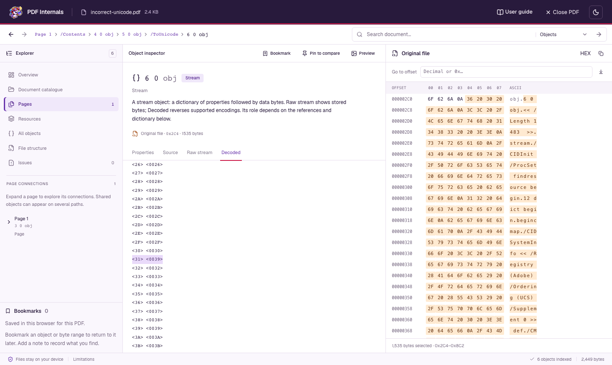

# PDF Internals Viewer

Explore PDF objects, references and streams alongside their original bytes, with an optional page preview. Inspection is read-only and runs locally in your browser.

**[Open the app](https://pdf-internals-viewer.pages.dev)** · [User guide](https://pdf-internals-viewer.pages.dev/guide) · [Examples](https://pdf-internals-viewer.pages.dev/examples) · [Limitations](https://pdf-internals-viewer.pages.dev/limitations)

Questions and ideas: [Discussions](https://github.com/antonsamper/pdf-internals-viewer/discussions). Bugs: [issues](https://github.com/antonsamper/pdf-internals-viewer/issues).

<picture>
  <source media="(prefers-color-scheme: dark)" srcset="docs/images/inspector-dark.png">
  
</picture>

## Product principles

- Preserve source truth. Original bytes appear only where an exact source range exists, and decoded or reconstructed values are labelled as such.
- Make relationships navigable. A page leads to its content stream, its resources and the objects that refer to it.
- Keep files local. Documents are parsed in the browser and never uploaded.
- Explain partial results. Parse failures and unsupported features are shown, and whatever was recovered stays usable.

## Run locally

Requires Node.js 22.18+ and pnpm 10.33.4 (pinned in `packageManager`).

```sh
pnpm install --frozen-lockfile
pnpm run dev
```

Open the URL printed by Vite. Installation prepares the pinned parser and preview dependencies; see [dependency setup](docs/DEPENDENCIES.md).

## Project documentation

- [Contributor workflow](AGENTS.md) and [design system](DESIGN.md)
- [Parser capabilities](docs/PARSER.md) and [preview engine](docs/PREVIEW.md)
- [Dependencies](docs/DEPENDENCIES.md), [preview backport and known advisory](docs/PREVIEW-VALIDATION.md) and [third-party notices](docs/NOTICES.md)
- [Public content and sample maintenance](docs/PUBLIC-CONTENT.md)
- [Browser verification](docs/BROWSERS.md) and [performance](docs/PERFORMANCE.md)
- [Cloudflare hosting and deployment](docs/HOSTING.md)
- [Security policy](SECURITY.md)

Built with TypeScript, React, Vite and shadcn/ui using Base UI. The bundled sample PDFs are original fixtures; [public content maintenance](docs/PUBLIC-CONTENT.md) documents their generators and provenance.

## Deployment

Merges to `main` deploy automatically to Cloudflare Pages after all checks pass. See [hosting](docs/HOSTING.md).
